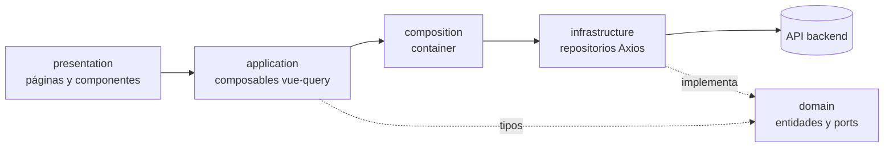

# Arquitectura del frontend

Guía para quien mantenga el código: cómo se organizan las capas, cómo viaja un dato desde la API hasta la pantalla
y qué convenciones seguir.

## Capas



| Capa | Carpeta | Regla |
|---|---|---|
| Dominio | `src/domain/` | Entidades (`*.entity.ts`), ports (`*.port.ts`: contrato de cada repositorio) y errores. **No importa Vue, Axios ni nada de las otras capas** |
| Aplicación | `src/application/` | Composables que envuelven vue-query (`useExpedientesList`, `useCrearExpedientes`…) y algunos casos de uso. Solo hablan con el `container` |
| Composición | `src/composition/container.ts` | Único lugar donde se crean los repositorios (`new XxxRepositoryImpl()`). Cambiar una implementación es tocar una línea |
| Infraestructura | `src/infrastructure/` | `http/axios.client.ts`, repositorios (`*Repository.impl.ts`) y stores de Pinia |
| Presentación | `src/presentation/` | Páginas, componentes, router y utilidades de formato. No llama a Axios directamente |

## Cómo llega un dato a la pantalla

Ejemplo: la lista de expedientes.

1. La página llama `const { data } = useExpedientesList()`.
2. El composable (`application/composables/useExpedientes.ts`) define la clave de caché `['expedientes']` y llama
   `container.expedientes.getAll()`.
3. `ExpedientesRepositoryImpl` hace `httpClient.get('/lf-itse/expedientes/')`.
4. vue-query guarda la respuesta 5 minutos; otra pantalla que pida lo mismo la reutiliza sin ir al servidor.
5. Las mutaciones (`useCrearExpedientes`, `useAnularExpediente`…) invalidan la clave al terminar, y las listas se
   recargan solas.

Para una entidad nueva: entidad y port en `domain`, repositorio en `infrastructure`, registro en `container.ts`,
composable en `application` y, al final, la página.

## Sesión

- **Ingreso**: `POST /auth/jwt/create/` (personal) o `POST /publico/cuenta/ingresar/` (ciudadano). Se guarda el
  usuario y el token de acceso en el store `useAuthStore` (persistido en `localStorage`, clave `auth-storage`) y el
  token de renovación en `auth-refresh-token`.
- **Cada pedido** lleva `Authorization: Bearer <token>` (interceptor de `axios.client.ts`).
- **Token vencido**: ante un `401`, el interceptor pide uno nuevo con el token de renovación, encola los pedidos que
  fallaron mientras tanto y los reintenta. Si la renovación falla, borra la sesión y lleva al login.
- **Endpoints públicos** (`/publico/…`): un `401` significa "documento o clave incorrectos" y llega tal cual al
  formulario; no se intenta renovar nada.
- **Permisos al día**: al cargar la app, el router relee el usuario del servidor (`refrescarUsuario`). Si un
  administrador cambió sus casillas, aplican al recargar, sin cerrar sesión.

## Permisos en la interfaz

Cada ruta declara en `meta` quién puede entrar:

```ts
{ path: 'admin/itse', component: ItsePage, meta: { allowedRoles: ['ADMIN_MUNICIPALIDAD'], permisos: ['itse'] } }
```

- `permisos`: basta **una** de las casillas (`authStore.puede([...])`).
- `allowedRoles`: rol requerido. Si no coincide, el router lleva a la pantalla de inicio de ese rol
  (`/admin`, `/inspector` o `/ciudadano`).
- El **menú lateral** (`AppSidebar.vue`) se arma con las mismas `meta`: nadie ve opciones que no puede abrir.
- Dentro de una pantalla, los botones se muestran según `authStore.puede(...)` (por ejemplo, Expedientes es de
  solo consulta para Licencias e ITSE).

Esto es solo para que la interfaz no muestre de más: **el servidor aplica las mismas reglas en cada pedido**. Los
tests de `presentation/router/permisos.spec.ts` fijan qué ve cada perfil.

## Componentes compartidos

| Componente | Uso |
|---|---|
| `templates/AdminLayout`, `InspectorLayout`, `CitizenLayout` | Marco de cada tipo de usuario (cabecera, menú) |
| `organisms/CrudTable` | Tabla con búsqueda, paginación y acciones |
| `molecules/LargeModal` | Modal de formulario con indicador de borrador |
| `molecules/SearchableSelect` | Selector con buscador (personas, expedientes, TUPA…). Busca sin importar tildes ni mayúsculas |
| `molecules/SelectorAcompanantes` | Equipo de inspección (responsable + hasta 3 acompañantes) |
| `organisms/ArchivosAdjuntos` | Adjuntos con subida y baja con motivo; prop `soloConsulta` |
| `organisms/DenegatoriaModal` | Registro de denegatoria de licencia o ITSE |
| `organisms/TarjetaTramite` | Un trámite como lo ve el ciudadano; prop `sigueTema` para el modo oscuro |
| `useToast`, `useDialog` (`useNotificationStore`) | Avisos y confirmaciones |

## Convenciones

- **Idioma**: nombres, comentarios y textos en español, como el dominio municipal.
- **Fechas**: la API envía `AAAA-MM-DD`. Para mostrarlas, partir la cadena en lugar de usar `new Date()`, que
  desplaza un día por la zona horaria (ver `presentation/utils`). Los tests corren con `TZ=America/Lima`.
- **Borradores**: los formularios largos usan `useFormDraft`, que guarda lo escrito en `localStorage`
  (`muni_draft_*`) mientras se crea un registro. Al editar uno existente no guarda borrador.
- **Modo oscuro**: clase `.dark` en `<html>`, preferencia en `muni_theme`. Usar variantes `dark:` en cada color.
  Las páginas públicas (login, consulta, ingreso del ciudadano) son siempre claras: sus campos fijan texto y fondo
  explícitos.
- **Errores de la API**: mostrar `extractErrorMessage(error)` y, en formularios, `extractFieldErrors(error)` para
  marcar cada campo.
- **Tests**: un `*.spec.ts` junto al archivo que prueba.
